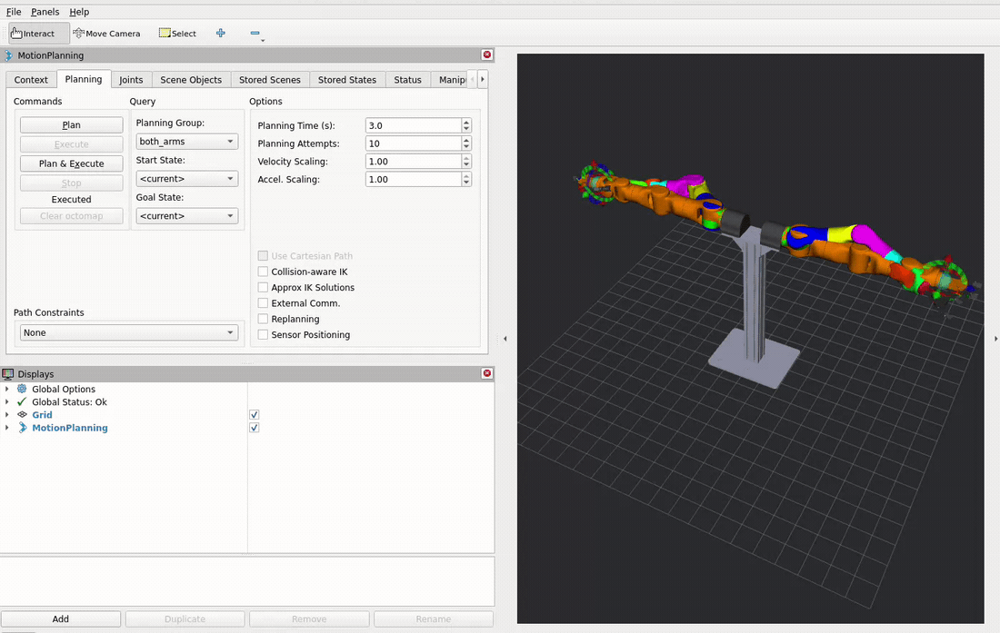
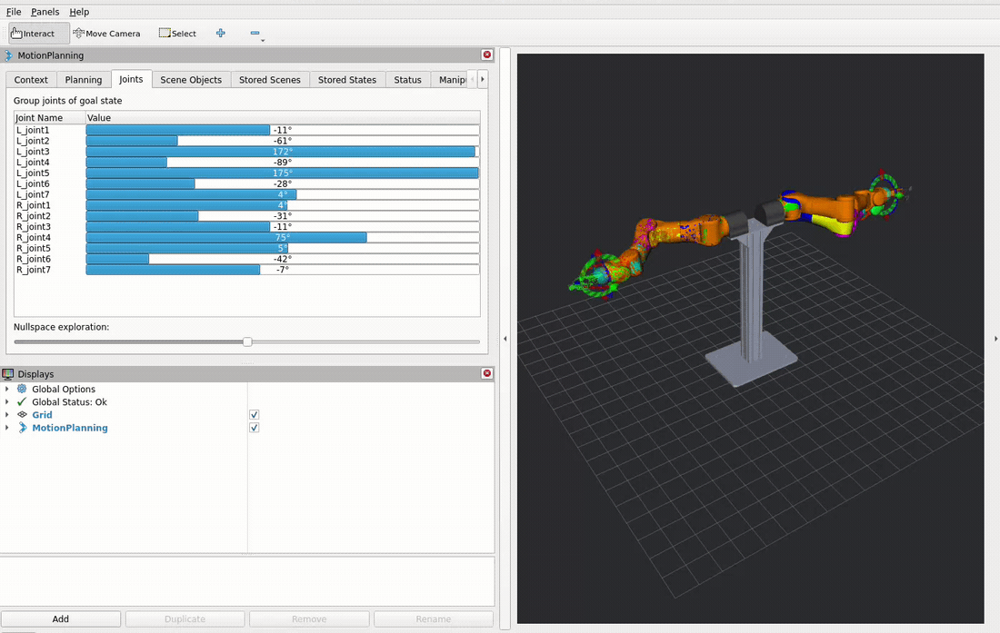
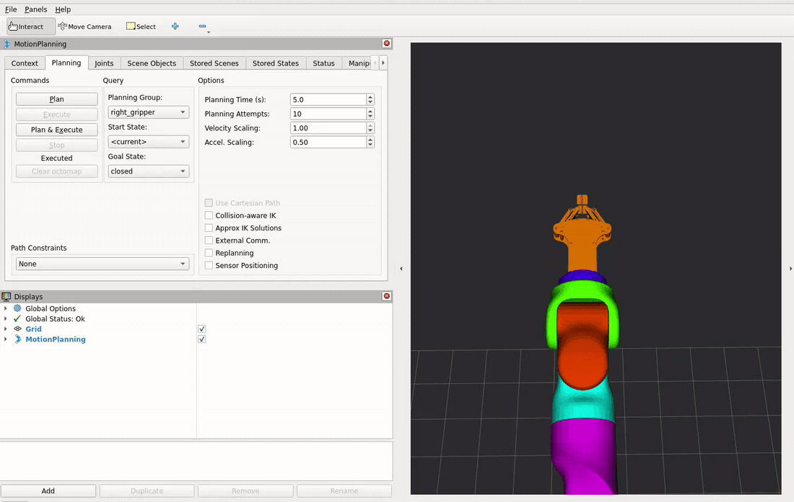

<div align="center">

# CoArm7 ROS 2

**基于 MoveIt 2 的 CoArm7 双臂与夹爪控制**

Ubuntu 22.04 · ROS 2 Humble · x86_64 / ARM64

[安装编译](docs/INSTALL.md) · [配置说明](docs/CONFIGURATION.md) · [真机运行](#hardware) · [RViz 操作](#rviz) · [远程 RViz（可选）](docs/REMOTE_RVIZ.md)

</div>

---

CoArm7 ROS 2 提供双臂运动规划、夹爪开合控制及 RViz 可视化操作，支持单臂、双臂和双夹爪联合目标。

| 功能 | 说明 |
| --- | --- |
| 双臂规划与执行 | 拖动末端或设置关节目标，使用 OMPL 规划运动 |
| 夹爪开合 | 选择 open / closed 或指定开度，使用 PTP 规划与终点式控制 |
| 离线演示 | 使用 fake 验证模型、规划和操作流程 |

<a id="hardware"></a>
## 真机运行

> **实机运行前：** 控制与 SYNC 周期为 **5 ms（200 Hz）**，控制器需要稳定的实时调度和 CAN 通信。请先完成 [实时权限与 CPU 配置](docs/CONFIGURATION.md#realtime)。通用模板不固定 CPU 编号；应按本机核心、内核及负载核对配置并验证周期，不能直接照搬其他机器的 CPU 编号。

完成 [安装编译](docs/INSTALL.md)，按 [配置说明](docs/CONFIGURATION.md) 准备实机配置。以下示例使用 `~/.config/coarm7/hardware_reviewed.yaml`。

```bash
source /opt/ros/humble/setup.bash
source ~/coarm7_ws/install/setup.bash
ros2 run coarm7_bringup start_coarm7.py --mode hardware \
  --hardware-config ~/.config/coarm7/hardware_reviewed.yaml
```

启动会读取反馈、使能保持并启动双臂与夹爪控制器。确认其他程序已交出 CAN，等待终端显示 `CoArm7 startup: Ready:` 后，在 RViz 中设置目标。

<a id="rviz"></a>
## RViz 操作

### 双臂规划与执行

1. Planning Group 选择 `left_arm`、`right_arm` 或 `both_arms`，Start State 选择 `<current>`。
2. 拖动末端标记或在 Joints 中设置目标；也可选择 `home` / `ready` 命名状态。
3. 点击 **Plan** 预览路径，再点击 **Execute**；也可直接使用 **Plan & Execute**。

**拖动末端设置目标**



*演示已省略部分规划等待，保留原速操作与运动画面。*

**修改关节角设置目标**



*演示已省略部分规划等待，并以 2 倍速播放。*

### 夹爪开合

1. Planning Group 选择 `left_gripper`、`right_gripper` 或 `both_grippers`。
2. Goal State 选择 `open` / `closed`，或在 Joints 中设置夹爪关节角。
3. 点击 **Plan & Execute**，观察实际开合和反馈模型。



## 离线演示

加载工作区后启动 fake，使用模拟反馈控制双臂和夹爪，RViz 操作方式与实机一致：

```bash
ros2 run coarm7_bringup start_coarm7.py --mode fake
```
